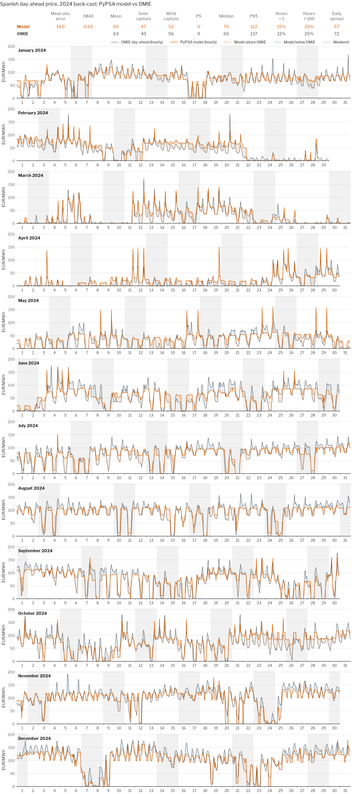
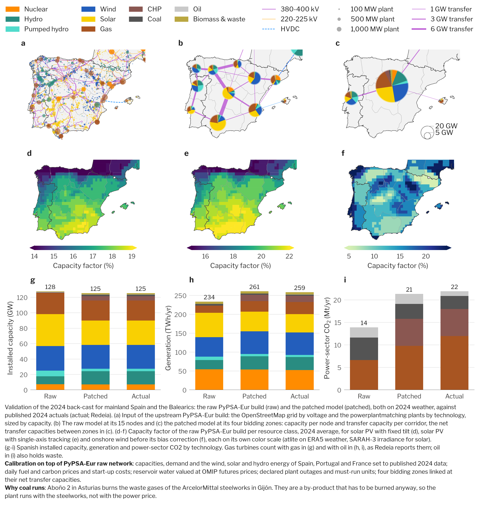

# Spain Price Back-cast

A pet side project: how far can a [PyPSA-Eur](https://github.com/PyPSA/pypsa-eur)
dispatch model go in back-casting an hourly day-ahead price?

I picked a [hard case](#hard-case), Spain in 2024, and played it [fair](#fair): Portugal
and France are in the model, and no result of the 2024 day-ahead market is used as an
input.




*Spain's day-ahead price in 2024, month by month: the market (OMIE, gray) and the model
(orange). The shading marks where the model is too high (orange) or too low (blue).
[Vector version](results/validation/price_backcast_patched.pdf).*

## The rules of the game

<a id="hard-case"></a>

**1. A hard case: Spain, 2024.** Monthly mean prices ran from 14 EUR/MWh in April to 111
in December. A wet year with 35 TWh of hydro, so the result hinges on the water value.
The solar fleet grew by a quarter within the year. Only a quarter of the gas burnt was
sold in the day-ahead auction; the rest was scheduled later, by the grid operator and in
later markets.

<a id="fair"></a>

**2. The neighbors are in the model.** Portugal and France are modeled with their own
plants, weather and demand. How much power crosses Spain's borders with them is the
model's decision in every hour, limited only by the published transfer capacities.
Copying the measured flows would hand the model a large part of the answer. The model
has to end somewhere: France's outer borders carry their measured flows, and Spain's
small exports to Morocco and Andorra are fixed.

**3. No peeking.** I may improve what the model knows about the physical system:
weather, plants, fuel prices, outages. I may improve how the model works. I may not
give it anything the market only revealed through the outcome I am trying to rebuild:
the prices, the cleared schedules, or the decisions plant owners took because of them.

| The shortcut | What the model uses instead |
|---|---|
| Value the water in the reservoirs at the 2024 prices themselves | The futures price of each day, quoted two or more days before delivery on the OMIP exchange: what every trader could see before bidding ([step 32](doc/validation_log.md#step-32)) |
| Switch plants off in the hours they stood still in 2024 | Only the outages their owners declared (maintenance, faults). A shutdown because prices are low is a market outcome, so the model has to find it itself ([steps 26](doc/validation_log.md#step-26), [31](doc/validation_log.md#step-31)) |
| Copy the hourly gas schedule the grid operator ordered after each auction | One constant: the gas the operator keeps running when the market schedules none ([step 11](doc/validation_log.md#step-11)) |
| Scale solar output month by month until it fits the measurements | The physical causes: most of the fleet tracks the sun, and it grew through the year ([steps 19](doc/validation_log.md#step-19), [27](doc/validation_log.md#step-27)) |
| Limit hydro to the peaks it reached in each month of 2024 | The highest output the fleet reached in seven years ([step 12](doc/validation_log.md#step-12)) |

**4. Right before better.** Every change has a physical or market reason and a public
source ([doc/data_sources.md](doc/data_sources.md)). The MAE is reported for each step
but does not decide it: eight of the 32 steps raised it and stayed. After every step the
model must still pass [eight gates](doc/validation_log.md#gates) on the year's energy
volumes.

## The score

The starting point is PyPSA-Eur with a CO2 price added and Spain's 2024 energy volumes
calibrated. Its price misses by 33.2 EUR/MWh on average (mean absolute error, MAE):
worse than a naive forecast, which repeats the price of the same hour a day or a week
earlier and misses by 21.7
([Lago et al. 2021](https://doi.org/10.1016/j.apenergy.2021.116983)). After 32 steps
the model misses by **14.0** (0.65 of the naive error, correlation 0.91). The naive
forecast has seen every real price up to yesterday; the model has seen none.

| 2024, EUR/MWh | Model | Market (OMIE) |
|---|---|---|
| Mean price | 64.6 | 63.2 |
| Price earned by solar | 47.3 | 42.5 |
| Price earned by wind | 52.2 | 55.7 |
| Hours below 1 EUR/MWh | 14.7% | 12.1% |
| Hours above 100 EUR/MWh | 20.5% | 25.4% |
| Highest minus lowest hour of the day, mean | 57 | 72 |
| 95th percentile | 122 | 137 |




## What the model still gets wrong

See the [caveats](doc/validation_log.md#caveats) and the
[open items](doc/decision_log.md#c-open-items).

## Calibration step by step

Each step is one change with its reason and source in the
[validation log](doc/validation_log.md#steps). ΔMAE is the change of the error in
EUR/MWh on top of all steps before (positive is worse; ±0.0 is below 0.05). The last
column says where a change belongs:

- **Upstream**: a general issue or feature, a candidate for PyPSA-Eur or its data
  packages.
- **Method**: the idea carries to other countries; the data are national.
- **Local**: data or rules of this system.

| Step | Change (in the order found) | ΔMAE | MAE | Belongs |
|---|---|---|---|---|
| 0 | Starting point: PyPSA-Eur at 15 nodes, CO2 price added, 2024 energy volumes calibrated ([below](#before-the-price-what-a-fresh-pypsa-eur-build-gets-wrong-for-spain)) | | 33.2 | |
| [1](doc/validation_log.md#step-1) | One node per bidding zone, borders at their transfer capacity, as the market clears | +1.0 | 34.1 | Method |
| [2](doc/validation_log.md#step-2) | Annual gas price corrected: the source report contradicts its own table | −1.3 | 32.8 | Local |
| [3](doc/validation_log.md#step-3) | Daily gas hub and CO2 allowance prices instead of annual means | −4.9 | 27.9 | Method |
| [4](doc/validation_log.md#step-4) | Water valued at the month's mean realized price (in-sample; replaced in step 30) | −5.4 | 22.5 |  |
| [5](doc/validation_log.md#step-5) | Biomass and waste plants run at a fixed output: they burn the fuel they have | −0.2 | 22.3 | Method |
| [6](doc/validation_log.md#step-6) | French pumped storage pumps at its pumping capacity, not its turbine capacity | 0.0 | 22.3 | Upstream |
| [7](doc/validation_log.md#step-7) | Part of Spanish reservoir hydro runs whatever the price (minimum flows, cascades) | −0.6 | 21.7 | Local |
| [8](doc/validation_log.md#step-8) | Portuguese pumped storage: pumping power and storage energy as the plants report them | −0.6 | 21.1 | Upstream |
| [9](doc/validation_log.md#step-9) | Spanish nuclear availability by month (replaced in step 26) | −0.6 | 20.5 |  |
| [10](doc/validation_log.md#step-10) | French demand, solar, wind, bioenergy and pumping set to RTE's 2024 figures | −0.1 | 20.4 | Local |
| [11](doc/validation_log.md#step-11) | Gas the grid operator orders up for security runs outside the merit order | −1.3 | 19.0 | Local |
| [12](doc/validation_log.md#step-12) | Spanish hydro capped at the highest output the fleet delivered in 2019–2025 | −0.3 | 18.7 | Upstream |
| [13](doc/validation_log.md#step-13) | One coal unit burns steelworks gases and runs whatever the price | −0.3 | 18.4 | Local |
| [14](doc/validation_log.md#step-14) | Start-up costs of gas and coal plants, in linear form | +0.0 | 18.4 | Method |
| [15](doc/validation_log.md#step-15) | Gas price converted from higher to lower heating value | +0.6 | 19.0 | Upstream |
| [16](doc/validation_log.md#step-16) | Hydro inflow counted after turbine losses | −0.7 | 18.4 | Upstream |
| [17](doc/validation_log.md#step-17) | Wind factor solved so that the capped profiles hold the published energy | −0.6 | 17.7 | Local |
| [18](doc/validation_log.md#step-18) | Start-up cost for Spanish reactors, which do not cycle | −0.2 | 17.5 | Method |
| [19](doc/validation_log.md#step-19) | 60% of the Spanish solar fleet on single-axis trackers instead of all on fixed tilt | +0.1 | 17.7 | Upstream |
| [20](doc/validation_log.md#step-20) | Portuguese gas cogeneration added at its monthly output | −0.2 | 17.4 | Local |
| [21](doc/validation_log.md#step-21) | Mainland and Balearics kept apart: demand, cogeneration and the price compared | −0.2 | 17.2 | Local |
| [22](doc/validation_log.md#step-22) | The must-run hydro of step 7 takes its water after turbine losses | +0.1 | 17.3 | Local |
| [23](doc/validation_log.md#step-23) | Portuguese and French hydro turbine capacities as published | 0.0 | 17.3 | Local |
| [24](doc/validation_log.md#step-24) | Portuguese solar: the grid-connected fleet only | +0.1 | 17.4 | Local |
| [25](doc/validation_log.md#step-25) | One reservoir per zone; Portuguese and French reservoir sizes and French inflow as published | 0.0 | 17.4 | Upstream |
| [26](doc/validation_log.md#step-26) | Outages of nuclear, gas and coal plants as their owners declared them, hour by hour | +0.3 | 17.7 | Method |
| [27](doc/validation_log.md#step-27) | Wind and solar fleets grow month by month between the two year-end capacities | −0.2 | 17.5 | Method |
| [28](doc/validation_log.md#step-28) | Wind and solar energy includes what was curtailed in 2024 | −1.8 | 15.7 | Method |
| [29](doc/validation_log.md#step-29) | Reservoir inflow by month from the water balance of the reservoirs | −0.1 | 15.6 | Upstream |
| [30](doc/validation_log.md#step-30) | Water valued at week-ahead futures; no realized price is left among the inputs | +0.1 | 15.7 | Method |
| [31](doc/validation_log.md#step-31) | Reactors online keep at least 60% of their output | −0.2 | 15.4 | Local |
| [32](doc/validation_log.md#step-32) | Water valued at the futures of each day, quoted two or more days ahead | −1.4 | 14.0 | Method |

### Before the price: what a fresh PyPSA-Eur build gets wrong for Spain

Step 0 already holds the corrections of the energy volumes
([findings](doc/validation_log.md#raw-findings),
[patches](doc/validation_log.md#patches)).

| Fresh build against 2024 | Cause | Belongs |
|---|---|---|
| Wind 21% low | One profile per region averages over all land; plants stand on the good sites. Weather data underrate Iberian ridge winds | Method |
| Solar 46% high | The plant inventory counts rooftop self-consumption; the demand does not | Method |
| Hydro 30% low | Inflow is normalized to statistics that end before 2024, a wet year | Upstream |
| Gas too cheap | No CO2 price in the default build | Local |
| Nuclear fuel three times too expensive | A unit label in the cost data counts the plant efficiency twice | Upstream |
| No cogeneration, no solar thermal | Not part of the electricity-only model | Local |
| France pushes 28 TWh into Spain | Line ratings instead of commercial transfer capacities | Local |
| Pumped storage and reservoirs oversized | The hydro database counts river cascades as storage | Upstream |
| Biomass and waste at full output all year | Fuel-limited plants without a limit | Method |
| Lignite plants that closed years ago run baseload | Stale plant inventory | Upstream |

### Candidates for upstream

- **Pumped storage pumps at turbine capacity.** One capacity serves both directions;
  the hydro database reports pumping power and storage energy per plant (steps 6, 8).
- **All existing solar is fixed tilt.** Fleets with many trackers have a flatter noon
  and wider shoulders (step 19).
- **Heating value.** Gas hubs (TTF, the Spanish MIBGAS) quote energy on higher heating
  value; the plant efficiencies and emission factors of
  [technology-data](https://github.com/PyPSA/technology-data) use the lower
  one. A hub price fed in unconverted makes gas plants 11% too cheap (step 15).
- **Nuclear fuel price.** The cost data label it per MWh of heat; its source reports it
  per MWh of electricity.
- **Hydro energy.** Inflow is scaled to generation statistics and then passes a 90%
  turbine efficiency, so reservoirs deliver 10% less than the statistics (step 16).
  Years after the statistics end take the median year. Inflow is shared among plants by
  turbine capacity, so nodes with little storage spill (step 25).
- **Hydro output ceiling.** Installed turbines are not deliverable capacity: head,
  cascades and irrigation rules keep Spain's 20.4 GW below 11.8 GW in every year of
  2019–2025. ENTSO-E generation data give such a ceiling for every country (step 12).
- **Inflow by month.** The runoff model knows no irrigation or evaporation, so it puts
  too much water into summer. The reservoir water balance from ENTSO-E data (output
  plus the change in stored energy) gives each month's share (step 29).

## The model

- **Base**: PyPSA-Eur v2026.09.0 as a pinned git submodule. No upstream file is
  modified; every choice lives in the `config/` overlay and this repository.
- **Geography**: four bidding zones (mainland Spain, Balearics, Portugal, France)
  linked by published net transfer capacities. PyPSA-Eur builds 15 nodes, which the data
  corrections work on before they are merged.
- **Time**: one year at hourly resolution, solved in one piece with perfect foresight.
- **Fleet**: frozen at 2024. The model solves dispatch only, as a linear program.
- **Price**: the Spanish price of an hour is the price of the mainland zone, the market
  OMIE clears.
- **Solver**: HiGHS (open source). An hourly solve needs about 11 GB of memory.

## Run it

Install [pixi](https://pixi.sh) and clone with `--recursive`. One command runs
everything, including the installation of the pinned environment: the upstream build,
the raw and patched back-casts, their validation reports and the price comparison.

```bash
pixi run --manifest-path pypsa-eur/pixi.toml snakemake -c all
```

The repository has no environment of its own: it runs in the submodule's pixi
environment, so every step uses the package versions the pinned PyPSA-Eur release was
tested with. The time series (OMIE prices, fuel prices, OMIP futures, measured
generation, reservoir levels, declared outages, French border flows) are retrieved once
with the `scripts/retrieve_*.py` scripts and stored in `data/custom/`.

## LLM-friendly extensive docs

- [doc/validation_log.md](doc/validation_log.md)
- [doc/decision_log.md](doc/decision_log.md)
- [doc/data_sources.md](doc/data_sources.md)

## License

A pet project, shared in the hope that it is useful. Build on it
as you like.

MIT © 2026 Iegor Riepin (TU Berlin, PyPSA Labs gGmbH); see [LICENSES/](LICENSES/),
[REUSE](https://reuse.software/)-compliant. Vendored third-party primary sources and the
series retrieved from providers keep their providers' licenses, registered per file in
[doc/data_sources.md](doc/data_sources.md).
